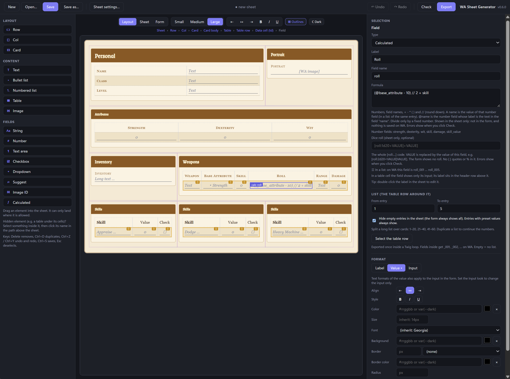
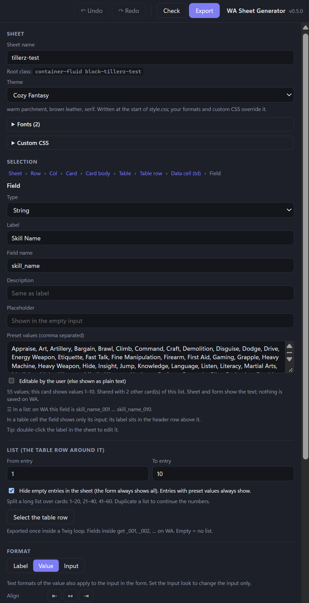
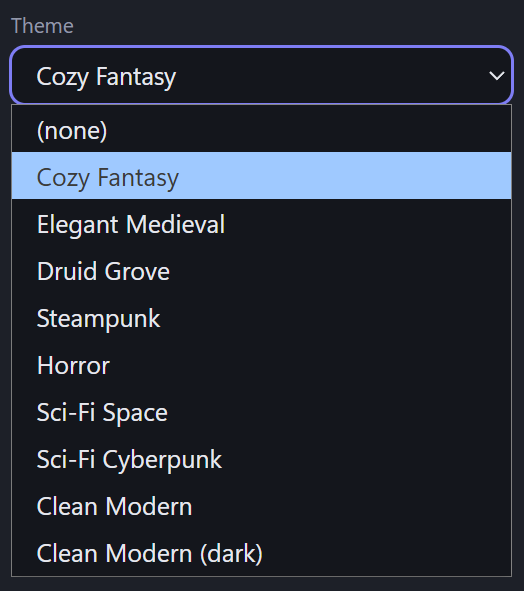
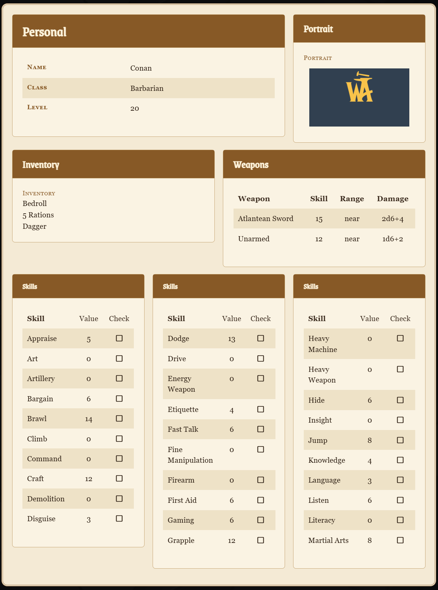

# WA Sheet Generator

[](https://github.com/Tillerz/wa-sheet-gen/actions/workflows/test.yml)

A small app for Windows, Linux and macOS to design **character sheets and stat blocks for [World Anvil](https://www.worldanvil.com)** by drag and drop, and export the five files World Anvil needs.

You build the sheet visually. The app writes clean Twig, CSS and YAML that pass World Anvil's security filter.



More in [Screenshots](#screenshots).

## Features

- **Visual editor**: drag rows, cols, cards, tables, lists, texts and images into the sheet. Bootstrap 5 grid with col widths for small, medium and large screens.
- **All World Anvil field types**: text, number, text area, checkbox, dropdown, text with suggestions, and WA image ID.
- **Tables made for sheets**: drop a field into a cell, and its label lands in a `th`, its input in the next `td`. Or put all labels on top, in a header row, for skill and weapon tables. Column widths are set by dragging the header cells.
- **Lists**: repeat a row, col, card, table row or list item, up to entry 199. It is exported once inside a Twig loop, and fields become `skill_001`, `skill_002`, …, like hand-made WA sheets. Long lists can be split over several cards (1–20, 21–40, 41–60). Preset values give every entry its own text, e.g. skill names, either fixed or as an editable default.
- **Formatting without code**: alignment, bold, italic, underline, colors, font sizes, fonts, borders, radius, backgrounds and bullet styles. Everything goes into CSS classes, so you can still adjust the look in the CSS later.
- **Themes**: Cozy Fantasy, Elegant Medieval, Druid Grove, Steampunk, Horror, Sci-Fi Space, Sci-Fi Cyberpunk, Clean Modern, Clean Modern (dark) and Minimal (light/dark), with striped rows in tables and lists. Your own formats and CSS override the theme.
- **Fonts**: a library of fonts used on World Anvil sheets (one click to add), or your own font file links. They go into `approved.css` and show in the editor too.
- **Custom CSS**: extra rules for `style.css` and `approved.css`, checked against World Anvil's rules.
- **Looks like it will on World Anvil**: the editor uses the same Bootstrap version as World Anvil sheets (5.0.1, CSS only) and applies exactly the CSS that the export writes, made by the same code. The **Sheet** and **Form** previews are not a separate imitation: they are the exported Twig files themselves, filled with sample data. What can still differ is what World Anvil adds around the sheet: the site's own styles and theme colors (`--dark`, `--light`), its page font, Font Awesome icons and `[img:…]` images, which the editor only stands in for.
- **Built-in checks for World Anvil's rules**: no `);`, no quotes or `%` inside `( )` in CSS, no class names starting with `sh` or `py`, no filtered words like `script`, no JavaScript, unique field names. The export stops with a clear list of problems.
- **Comfortable editor**: resizable sidebars, a path bar above the sheet to reach hidden elements (e.g. a table under its cells), a sheet settings panel, numbers while you resize, undo / redo, autosave (nothing is lost on a reload or crash), keyboard shortcuts, recent sheets, light and dark mode.
- **Small and private**: one program file, no installer, no account, no internet needed (except to load your own font URLs in the preview).

## What it exports

| File | Content |
| --- | --- |
| `import-to-wa.yml` | the field definitions |
| `basic-sheet.html.twig` | the sheet view |
| `edit-form.html.twig` | the form to enter data |
| `style.css` | all styles |
| `approved.css` | font definitions and CSS that only the approved field may hold (e.g. font urls or gradients) |

Your design is saved as `project.json` in the same folder, so you can open and change it later.

> [!WARNING]
> The "approved css" field is not visible to everyone. You either need a WA developer to add that css content or ask Tillerz to create the sheet in WA for you.

> [!NOTE]
> Things to remember:
>
> - If you create a sheet/block for a new system, WA dev team need to create this system for you in WA first.
> - If the sheet shall be available to everyone, the WA dev team needs to "publish" the sheet/block ('released to public').
> - The tool does not generate the tracker or the badge, but those are easy to do; the badge is a minimalistic version of the basic sheet, and the tracker is a stripped down version of the edit form.

## Install

**Requirements:** Windows 10/11, Linux (x86-64) or macOS (Apple silicon or Intel), and a modern browser (tested with Microsoft Edge; Chrome should work the same).

1. Download the archive for your system from the [Releases](../../releases) page: <!-- TODO: no release published yet -->
   - Windows: `wa-sheet-gen-v<version>-windows-amd64.zip`
   - Linux: `wa-sheet-gen-v<version>-linux-amd64.tar.gz`
   - macOS: `wa-sheet-gen-v<version>-macos-arm64.tar.gz` (Apple silicon) or `…-macos-amd64.tar.gz` (Intel)
2. Unpack it into any folder. There is nothing to install.
3. Start `wa-sheet-gen.exe` (Windows) or `./wa-sheet-gen` (Linux, macOS). A console window opens, and the editor opens in your browser. Close the console window (or press Ctrl+C) to quit.

Notes:

- The program is not signed. On Windows, SmartScreen may warn the first time: choose "More info" → "Run anyway". On macOS, remove the download mark once with `xattr -d com.apple.quarantine wa-sheet-gen`.
- `SHA256SUMS.txt` on the release page lets you check the download: `sha256sum -c SHA256SUMS.txt --ignore-missing`.
- Start options: `--no-browser` (do not open the browser, the address is printed instead), `--version`.

## Quick start

1. A new sheet starts with a "Personal" card and the required `name` field.
2. Set the **sheet name** on the right. The root class becomes `block-<sheet-name>`.
3. Drag elements from the left into the sheet. Double-click texts and labels to edit them. Right-click for more actions.
4. Select an element to change its settings and its format on the right.
5. Use **Sheet** and **Form** above the canvas to preview.
6. Click **Export**. The app checks the sheet, saves it, and writes the five files into the sheet's folder.
7. In World Anvil, paste the files into your sheet template.

### Keyboard shortcuts

| Keys | Action |
| --- | --- |
| Ctrl+S / Ctrl+Shift+S | save / save as |
| Ctrl+Z / Ctrl+Y | undo / redo |
| Ctrl+D | duplicate the selected element |
| Delete | delete the selected element |
| Esc | clear the selection |

## How it works

The app is one Go program. It starts a small web server on `127.0.0.1` (your own PC only) with a random port and a secret key, and opens the editor in your browser. The editor is plain HTML, CSS and JavaScript, with no third-party JavaScript libraries.

Settings like recent sheets, and the autosave of unsaved work, are stored in `%AppData%\wa-sheet-gen\settings.json` (Windows), `~/.config/wa-sheet-gen/settings.json` (Linux) or `~/Library/Application Support/wa-sheet-gen/settings.json` (macOS), with `autosave.json` next to it.

## Screenshots

### Layout View


### Sidebar



### Themes



### Examples

You can find the project files in [docs/examples/](docs/examples/). Copy an example folder, then open it with `Open…` in the app.

#### Example 1



## Build from source

You need:

- [Go](https://go.dev) (the version in `source/go.mod` or newer)
- [Node.js](https://nodejs.org) 22 or newer, for the editor tests
- `bash`, `curl`, `zip`, `tar` and `sha256sum` (Linux, macOS or WSL on Windows)

Three scripts in the repo root do the work:

| Script | What it does |
| --- | --- |
| `./build.sh` | checks the format (`gofmt`), runs `go vet` and the Go tests, then builds all platforms into `dist/<platform>/` and packs the release archives plus `SHA256SUMS.txt` |
| `./build.sh windows` | only the Windows build (quick, for trying it out); `./build.sh linux` works the same |
| `./test.sh` | all tests, one line per check: Go tests, editor model tests in Node, and an end-to-end run of the real program on `127.0.0.1` with a temporary settings folder |
| `./release.sh` | publishes the archives in `dist/` as a GitHub release (see below) |

The builds need no C compiler (`CGO_ENABLED=0`), so all four platforms are built on any machine:

| Folder in `dist/` | Program |
| --- | --- |
| `wa-sheet-gen-windows-amd64/` | `wa-sheet-gen.exe` |
| `wa-sheet-gen-linux-amd64/` | `wa-sheet-gen` |
| `wa-sheet-gen-macos-arm64/` | `wa-sheet-gen` (Apple silicon) |
| `wa-sheet-gen-macos-amd64/` | `wa-sheet-gen` (Intel) |

Without the scripts, one build is: `cd source && go build -o ../wa-sheet-gen .`

### Automatic checks on GitHub

`.github/workflows/test.yml` runs `./build.sh` and `./test.sh` on every push and pull request. It publishes nothing.

### Making a release

1. Raise `appVersion` in `source/version.go`.
2. Optional: write the release text in `docs/releases/v<version>.md` (one line per paragraph or list item).
3. Run `./build.sh` and `./test.sh`, and try the program yourself.
4. Commit everything.
5. Run `./release.sh`. It needs the GitHub CLI (`gh`, logged in) and a remote named `origin`. It refuses to run with uncommitted changes, an existing tag, or files changed after the last build. It asks before it publishes, then tags the commit, pushes, and creates the release with the archives.

### Tests in detail

```bash
./test.sh                                      # everything
cd source && go test ./...                     # only the Go tests
node --test source/webtest/*.test.mjs          # only the editor model tests (from the repo root)
```

The export is pinned by golden files in `source/testdata/full/`. After a wanted change to the output:

```bash
cd source && go test -run TestExportGolden -update
```

Then review the diff before you commit.

### Project layout

```txt
bible.md            design document: all rules and decisions
source/             Go server, generator and checks
source/web/         the editor (embedded into the program)
source/testdata/    sample project and expected export
source/webtest/     tests for the editor model
examples/           hand-made WA sheets used as reference
build.sh, test.sh, release.sh   build, test and publish (see above)
```

## Credits

- [Bootstrap 5.0.1](https://getbootstrap.com) CSS (MIT license) is embedded for the canvas.
- Made for the [World Anvil](https://www.worldanvil.com) community. This project is not affiliated with World Anvil.

## License

[PolyForm Shield License 1.0.0](LICENSE). Copyright (c) 2026 Tillerz.
